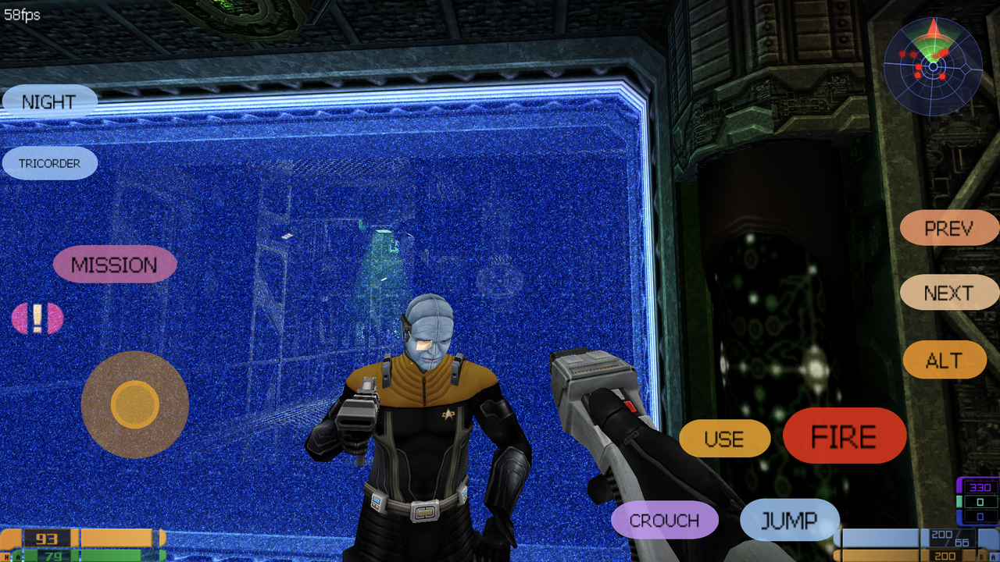

# Provenance: Elite Force II decomp (Android/Linux)

A native Android and Linux port of *Star Trek: Voyager — Elite Force II* (Ritual
Entertainment, 2003). The engine descends from id Tech 3 through
[OpenMoHAA](https://github.com/openmoh/openmohaa), with a from-scratch Vulkan
renderer written for this port. The game runs on your own retail installation —
**no game data is included**, and the DLL that ships with the game is used only
as a proof-of-ownership check. It is never executed.

A follow-up to my own Android ports —
[Voyager Elite Force: SP for Android](https://github.com/imjustadudegamer/VoyagerSP-Android)
(the first game) and
[Klingon Honor Guard: Android](https://github.com/imjustadudegamer/Klingon-Honor-GUARD-Android) —
and inspired by [VoyagerNX](https://github.com/faithvoid/VoyagerNX), faithvoid's Nintendo
Switch port of the first game.



## Why "Provenance"?

Every function, struct, table and constant in this port is held to a witness.
Where the original source was published, that source is the authority: id
Software's GPL engine release, and Ritual's own Elite Force II fgame code.
Everything else is read out of the shipping retail binaries, the little known Mac
PPC release first and the PC build as a secondary corroboration, and every value
is checked against the retail data that ships with the game. Behaviour is not
assumed from the binaries alone: the retail game itself is instrumented and
measured, and port behaviour is diffed against retail's own output. A claim that
cannot be tied to one of those is recorded as open rather than asserted. The
name says that the code carries its own evidence chain. Ask where a behaviour
comes from and there is an answer.

## Features

- Vulkan renderer, written for this port — the shipping default. The GLES 3.2
  twin ships beside it and is selectable in Graphics → Renderer.
- Touch controls: virtual stick, look area, and on-screen pills for fire, jump,
  crouch, use, night vision and the tricorder.
- Full gamepad support (SDL GameController, EF1-style layout — see the table below),
  sharing one key map with the touch controls.
- First-run game import through the system file picker — no storage permission needed.
- Widescreen support for the 3D view, the HUD and the 2D menus.
- Android 8.0+ (`arm64-v8a`, 16 KB page-size compatible) and Linux x86-64 from one tree.

## Requirements

- Android 8.0+ with a Vulkan driver, or Linux x86-64 with a Vulkan driver.
- Your own retail *Elite Force II* data: the game's `.pk3` paks and the game DLL.

## Install

### Android

1. Install the APK from Releases and launch it.
2. On first run, pick your retail paks and the game DLL in the file picker
   (multi-select). The game copies them into place and starts.
3. Manual placement, if you prefer:

```sh
adb push base/. /sdcard/Android/obb/com.provenanceef2/base/
```

### Linux

1. Download `ProvenanceEF2-<version>-x86_64.AppImage` from Releases, make it
   executable and run it.
2. On first run, a dialog asks for your retail installation folder — the one
   holding `EF2.exe` and its `base/` directory. The choice is remembered;
   nothing is copied.
3. Point the game yourself, if you prefer:

```sh
./ProvenanceEF2-<version>-x86_64.AppImage +set fs_basepath /path/to/elite-force-ii
```

or drop the retail `base/` directory into `~/.local/share/provenanceef2/`,
where the engine looks on its own. Configs and saves land in the same tree.
The Linux release is Vulkan only.

## Controls

Gamepad (EF1-style layout, remappable in the in-game menu):

| Input | Action |
|---|---|
| Left stick | Move (click: walk) |
| Right stick | Look (click: aim) |
| Right trigger | Fire |
| Left trigger | Alt-fire |
| Right shoulder | Next inventory item |
| Left shoulder | Previous inventory item |
| A | Jump |
| B | Crouch |
| X | Use |
| Y | Night vision |
| D-pad up | Reload |
| D-pad down | Context action (`+button3`) |
| D-pad left/right | Lean |
| Back | Objectives |
| Start | Menu |

Touch: virtual stick, look area, and the on-screen pills (fire, jump, crouch,
use, night vision, tricorder). Keyboard and mouse keep the retail layout
(WASD, mouse to aim and fire, wheel for inventory, `F6`/`F9` quick-save/load,
`n` night vision, `1`–`6` weapon select).

## Known issues

This port is not fully play tested and the campaign has not been played end to
end; expect the occasional stutter while a new effect compiles. The graphics
have been through a retail-diff pass — the Borg generator effects (plasma rings
and the sparkle dome), lens flares (including the through-wall bug), phaser
scorch marks, decal fade and lifetime, ship trails, beam shapes, the additive
light blend and the view bob are all checked against retail's own output — so
almost all of the graphical bugs reported here are fixed. What is still open:

- **No stencil shadows** — `cg_shadows 2` draws nothing on this renderer, so the
  character shadows are the simple set (`cg_shadows 1`, the default).
- **A few effects may still be missing** — unplayed areas can hide one; the
  dampening-field volumes draw only where retail itself draws them.
- **The GLES 3.2 renderer is selectable, not the default** — Graphics → Renderer
  switches between Vulkan and the GLES 3.2 twin; Vulkan remains the default and
  the renderer the release ships first. (On Linux the release is Vulkan only:
  the AppImage does not carry the GLES 3.2 module.)
- **Saves are one way in practice** — a save written here can load oddly or
  crash in retail, so back your saves up and finish a run in this port.
- **One deliberate divergence** — some scripted movement threads resume in this
  port that retail itself cannot resume from its own saves; this is kept on
  purpose and will not be "fixed".
- **REPORT YOUR ISSUES PLEASE!**

## Build

Everything needed to build is in this repository; no game data is required to
build, only to run.

Android: SDK (`android-35`), NDK `27.0.12077973`, CMake `3.31.5`, JDK 17+,
Gradle 8.13 (wrapper pins it):

```sh
echo "sdk.dir=$HOME/Android/sdk" > local.properties
app/build_apk.sh assembleDebug          # app/build/outputs/apk/debug/app-debug.apk
```

Linux x86-64: CMake 3.31.5+, Ninja, a Vulkan driver:

```sh
cd app/src/main/cpp && cmake --preset linux-gles3 && ninja -C build -j16
```

The Linux output lands in `build/Release/` (`provenanceef2` plus `game.so`,
`cgame.so`, `renderer_vulkan.so`, `renderer_gles3.so`), and reads its game data
from a `base/` directory beside it, or `+set fs_basepath /path/to/install`.

Linux release: `app/package_appimage.sh` builds the engine and packs one
relocatable AppImage, `app/appimage/dist/ProvenanceEF2-<version>-x86_64.AppImage`,
with a `.sha256` and a build-information file beside it. It needs CMake 3.31.5+,
Ninja and the SDL 2 and Vulkan development headers (`libsdl2-dev`,
`libvulkan-dev`); the AppImage tools themselves are downloaded once into
`~/.local/share/appimage-tools` and checked against the pins in
`app/appimage/tools.lock`. The version in the file name comes from
`app/src/main/cpp/VERSION`, the same file the engine banner and the APK read.
The Linux release is **Vulkan only** — the GLES 3.2 twin is an Android concern
and is configured out of this build (`-DBUILD_RENDERER_GLES3=OFF`).

```sh
app/package_appimage.sh
```

The AppImage carries no game data. Run it and point it at your own retail
installation:

```sh
./ProvenanceEF2-<version>-x86_64.AppImage +set fs_basepath /path/to/elite-force-ii
```

or drop the retail `base/` directory into `~/.local/share/provenanceef2/`, which
the engine searches on its own; configs and saves land in the same tree. The
image is bundled with the SDL it was linked against and nothing else from the
desktop — glibc, the X11/Wayland client libraries, ALSA/PulseAudio and the
Vulkan loader and driver all come from the host, so the image needs the build
machine's glibc or newer (that floor is measured and printed, not assumed).
`.github/workflows/appimage.yml` builds it by hand on an Ubuntu 22.04 runner,
which is the same 2.35 floor the EF1 port targets, and uploads it as an
artifact — no release is cut. The pipeline never runs the game: the image is
verified statically (`ldd -r`, `readelf`, `objdump`, `desktop-file-validate`,
`appstreamcli`, and an `--appimage-extract` round trip), and first launch is
yours.

## Licence

Mixed-licence work. The engine lineage is **GPL-2.0-or-later** (id Tech 3 via
ioquake3 and OpenMoHAA — keep the notices intact and ship the source). The Elite
Force II game layer is **not GPL**: the 2003 SDK portions carry Ritual's own
limited-use licence (`docs/EF2-SDK-licenseAgreement.txt`), and the reconstructed
client/UI code asserts no copyright and grants no rights — it remains the property
of its respective holders. **No game assets** are distributed here; you must own
the game ([GOG](https://www.gog.com/en/game/star_trek_elite_force_ii)). Unofficial
fan project, not affiliated with or endorsed by Ritual, Activision, id Software or
Paramount/CBS. See [LICENSING.md](LICENSING.md),
[CREDITS.md](CREDITS.md) and [THIRDPARTY.md](THIRDPARTY.md).

Parts of this port were built with the help of AI tools (model/texture formats,
the bot and NPC AI system, special effects, and engine/client reconstruction).
